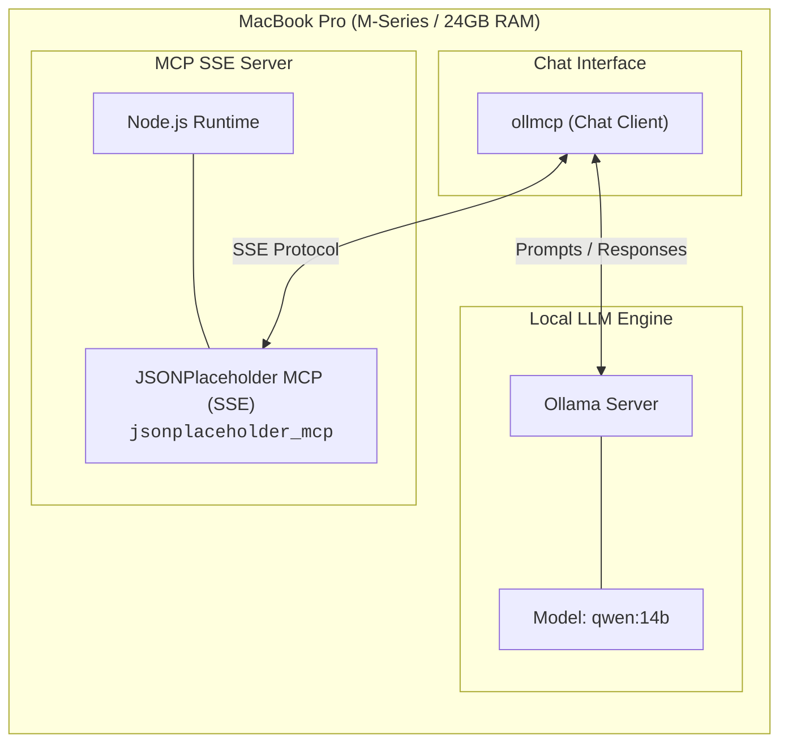
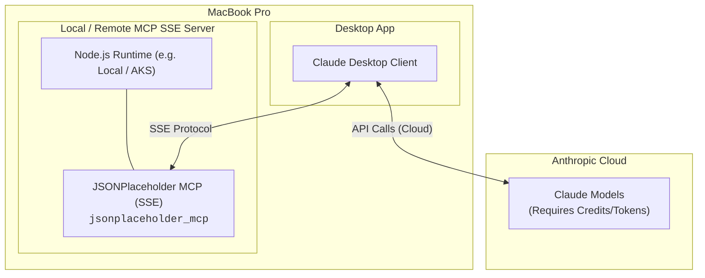

# JSONPlaceholder MCP Server (SSE)

This project implements a **Model Context Protocol (MCP) Server** based on **SSE (Server-Sent Events)** that exposes APIs from [JSONPlaceholder](https://jsonplaceholder.typicode.com/). It allows LLMs (Large Language Models) to interact with mock data (posts, users, comments, etc.) by executing dynamic API calls through dedicated tools.

## 🏗️ Transport Architectures: SSE vs. Stdio

The Model Context Protocol supports multiple communication transports. The two primary methods are **stdio** and **SSE (Server-Sent Events)**.

### 1. Stdio (Standard Input/Output)

* **How it works:** The LLM client (e.g., Claude Desktop) spawns the MCP server executable directly as a child process "on demand" whenever the application starts, communicating via `stdin` and `stdout`.

* **Pros:** Simple setup for local single-user development; no port management required.

* **Cons:**

  * Tied to local lifecycle (process starts and dies with the desktop app).

  * Logging can be noisy or easily pollute standard output buffers if not formatted carefully.

  * Cannot be shared across multiple clients or hosted on remote infrastructure.

### 2. SSE (Server-Sent Events over HTTP) — *Chosen Architecture*

* **How it works:** The MCP server runs as a standalone HTTP microservice listening on a network port. The client establishes a persistent SSE stream to receive server-to-client updates and uses HTTP POST requests for client-to-server messages.

* **Why SSE was chosen for this project:**

  * **Production-Ready & Cloud Native:** Enables deployment to containerized cloud platforms like **AKS (Azure Kubernetes Service)**, Amazon EKS, or Docker environments independently of client applications.

  * **Centralized Logging & Observability:** stdout/stderr can be captured cleanly by enterprise logging agents (e.g., Fluentd, Datadog, Azure Monitor) without interfering with protocol communication payloads.

  * **Scalability & Reusability:** Multiple users, web services, or LLM agents can connect to a single central MCP server instance.

## 🛠️ System Requirements & Local Installation

### Recommended System Requirements

* **Operating System:** macOS / Linux / Windows

* **Hardware (for 100% Local execution):** MacBook Pro or PC with at least 24GB RAM (recommended to run local models such as `qwen2.5:14b` or `qwen3:14b` via Ollama smoothly).

### Software Requirements & Node.js

* **Node.js:** Version `>= 18.x` (LTS recommended)

* **Package Manager:** `npm` or `yarn`

### Installation Steps

1. **Clone the repository and navigate to the project folder:**

   ```bash
   git clone <repository-url>
   cd jsonplaceholder_mcp
   ```

2. **Install Node.js dependencies:**

   ```bash
   npm install
   ```

3. **Start the MCP (SSE) Server:**

   ```bash
   npm run dev
   # or using the provided script:
   ./start_mcp.sh
   ```

   *By default, the server will start listening on the configured port for SSE event transmission.*

## 🧪 Testing the MCP Server

There are two primary approaches to test and interact with this MCP Server.

### 1. Fully Local Setup (Ollama + Qwen + OllMCP)

This configuration runs entirely on your local machine, making it **100% free, private, and offline**. Your local hardware hosts both the chat interface and the AI model execution.

* **LLM:** Ollama running `qwen2.5:14b` (or `qwen3:14b`)

* **Chat Client:** `ollmcp`

* **Pros:** Completely free (no token or API costs), full data privacy.

* **Cons:** Requires a powerful machine (e.g., M-Series Mac with 24GB+ RAM) and exhibits slightly slower response times compared to cloud providers.



#### How to Test Locally:

1. Ensure **Ollama** is running and the model is pulled:

   ```bash
   ollama run qwen2.5:14b
   ```

2. Start the MCP server:

   ```bash
   ./start_mcp.sh
   ```

3. Launch your local chat client `ollmcp` connected to the MCP Server SSE endpoint.

### 2. Hybrid Cloud Setup (Claude Desktop Client)

In this setup, the MCP Server runs locally on Node.js (or remotely in containerized infrastructure), while reasoning, tool usage execution, and output formatting are powered by **Anthropic's Cloud Models (Claude)** via the official **Claude Desktop** client.

* **LLM:** Claude 3.5 Sonnet / Claude 3 Opus (Cloud)

* **Chat Client:** Claude Desktop Client

* **Pros:**

  * **Speed:** Fast processing and response generation.

  * **Intelligence & Accuracy:** Significantly smarter at selecting tools and rendering clean, structured outputs.

* **Cons:** **Consumes API credits or subscription quota (Token Costs).**



#### Claude Desktop Configuration:

To connect the MCP server to Claude Desktop via SSE, add the server definition to your `claude_desktop_config.json`:

* **macOS:** `~/Library/Application Support/Claude/claude_desktop_config.json`

* **Windows:** `%APPDATA%\Claude\claude_desktop_config.json`

**Example SSE Configuration:**

```json
{
  "mcpServers": {
    "jsonplaceholder_mcp": {
      "url": "http://localhost:3000/sse",
      "transport": "sse"
    }
  }
}
```

> **Comparison Note:** If you were using the **stdio** mode instead of SSE, your configuration would instead launch Node on demand locally:
>
> ```json
> {
>   "mcpServers": {
>     "jsonplaceholder_mcp": {
>       "command": "node",
>       "args": ["/absolute/path/to/jsonplaceholder_mcp/src/index.js"]
>     }
>   }
> }
> ```

## 💡 Example Test Prompts

Use these prompts to test how different LLM setups (Local Qwen vs. Cloud Claude) execute tool calls and process relational data.

### Simple Queries (Single Entity Lookups)
1. **User Lookup:**
   > *"Show me all data and details for the user with username 'Samantha'."*
2. **Album Details:**
   > *"Retrieve all data for album #17."*
3. **User Posts:**
   > *"List all posts written by the user with email `Sincere@april.biz`."*

### Intermediate Queries (Relational Data & Aggregations)
4. **User Albums & Photo Count:**
   > *"Show me a table with all albums published by the user with username 'Delphine' (or 'Blake'), including the album ID, album title, and the number of photos in each album."*
5. **Comments Summary:**
   > *"Find the post with ID #5, list all of its comments, and calculate the average length of the comment bodies."*
6. **User Summary:**
   > *"For user ID #3, list their total number of posts, total number of albums, and total number of completed vs. uncompleted todos."*

### Advanced Queries (Multi-Entity Relations & Text Processing)
7. **Keyword Frequency Analysis Across User Comments:**
   > *"For each user in the system, check all comments to their posts, and count the occurrences of the word 'voluptatem' in the comment body. Show the user's name and the count of occurrences, sorted by count descending."*

   > 💡 **Prompt Strategy / Prompt Engineering Variant:**  
   > *Note on Model Reasoning:* Making several tool calls per prompt is fine, but performing nested loops for `users -> posts -> comments` can cause excessive tool calls. You can prompt the model with an explicit loading strategy to see how its reasoning changes:  
   >  
   > *"For each user in the system, count the occurrences of the word 'voluptatem' in the comments of their posts. To optimize performance, load all users, posts, and comments into context in bulk first, then compute the count from context. Show the user's name and count, sorted descending."*

8. **Complex Multi-Condition Search:**
   > *"Find all users who have at least one uncompleted todo item and have published more than 2 albums. For these users, list their top 3 posts along with the number of comments each post received."*

## 📜 License

This project is licensed under the ISC / MIT License.